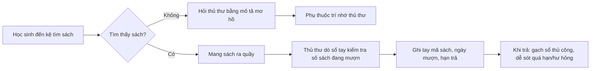
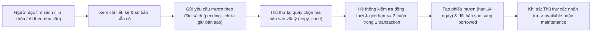

# T01 — Khảo sát thủ thư và người đọc (F01)

- **Mã công việc:** `T01` (Nhóm Khảo sát — `F01`)
- **Phụ trách:** Lý Thế An (`lythean2508`)
- **Người review:** Phạm Hiển
- **Tuần thực hiện:** Tuần 1 (`2026-11-30` → `2026-12-06`)
- **Rủi ro liên quan:** `R01` (Chưa có thư viện cho pilot — dùng danh mục giả lập có nguồn, cần xác nhận quy tắc với ít nhất 1 thủ thư trước phát hành)

> [!IMPORTANT]
> Theo nguyên tắc trung thực dữ liệu của kế hoạch (`F14`: *"Kết quả thực tế nhập sau, không giả định đã đạt"*), tài liệu này cung cấp:
> 1. **Tổng hợp 3 khó khăn cốt lõi, luồng mượn hiện trạng và nhu cầu tìm kiếm** làm cơ sở thiết kế `T02` và chốt quy tắc `T04`.
> 2. **Bộ câu hỏi phỏng vấn chuẩn hóa** cho **01 thủ thư** và **05 người đọc (học sinh)**.
> 3. **Bảng ghi nhận biên bản phỏng vấn thực tế** để điền trực tiếp khi làm việc với trường thử nghiệm.

---

## 1. Ba khó khăn chính tại thư viện trường học hiện tại

Qua phân tích nghiệp vụ thư viện trường phổ thông và đối chiếu mục tiêu dự án LibMate, 3 điểm nghẽn lớn nhất cần giải quyết trong MVP gồm:

1. **Học sinh biết nhu cầu nhưng không nhớ chính xác tên sách hoặc tác giả (Khó khăn tìm kiếm):**
   - Học sinh thường hỏi theo chủ đề/vấn đề tự nhiên như *"sách giúp bớt áp lực thi cử"*, *"sách giải thích vật lý thiên văn dễ hiểu"*, hoặc gõ thiếu dấu tiếng Việt.
   - Tra cứu từ khóa truyền thống hoặc tìm thủ công trên kệ khiến người đọc bỏ cuộc nếu không khớp đúng từ trong nhan đề.
2. **Nhầm lẫn giữa "Đầu sách" (Book) và "Bản sao vật lý" (Copy) khi quản lý tồn kho:**
   - Sổ tay hoặc bảng tính đơn giản thường chỉ đếm số lượng chung, dẫn đến tình trạng không biết cuốn nào đang rách/bảo trì (`maintenance`), cuốn nào đang nằm ở người mượn nào, hoặc hai học sinh cùng đăng ký bản cuối cùng.
3. **Mất thời gian đối chiếu thủ công tại quầy giao/trả và theo dõi quá hạn:**
   - Thủ thư phải dò sổ để kiểm tra học sinh đã mượn đủ tối đa (ví dụ 3 cuốn) hay chưa, tính nhẩm hạn trả (14 ngày), và tốn công lọc danh sách quá hạn cuối tuần/tháng.

---

## 2. Luồng mượn – trả hiện tại và luồng mục tiêu trên LibMate

### 2.1. Luồng thủ công hiện tại (Trước khi có LibMate)

### 2.2. Luồng số hóa mục tiêu trên LibMate (Chuyển sang T02 & T04)

---

## 3. Phân tích nhu cầu tìm sách của người đọc (Đầu vào cho F04 & F10)

| Nhóm nhu cầu thực tế | Ví dụ truy vấn điển hình của học sinh | Giải pháp trong LibMate |
| :--- | :--- | :--- |
| **Tìm đích danh tên sách / tác giả** | *"Mắt biếc"*, *"mat biec"*, *"Nguyễn Nhật Ánh"* | Tìm từ khóa hỗ trợ có dấu / không dấu (`F04`, `TC05`). |
| **Duyệt theo môn học / kệ sách** | Lọc nhóm *Toán học*, *Vật lý*, *Kỹ năng sống* và chỉ xem sách còn sẵn | Bộ lọc chủ đề + lọc còn bản sẵn có + phân trang (`T08`). |
| **Tìm theo vấn đề / cảm xúc / mục tiêu học tập** | *"Em hay mất tập trung khi ôn thi cần sách rèn thói quen"* | Tìm ngữ nghĩa AI local `multilingual-e5-small` trên metadata (`F10`, `T25`, `T26`). |
| **Khám phá sách liên quan** | Đọc xong 1 cuốn khoa học muốn tìm cuốn tương tự cùng mức độ | Khối *"Sách tương tự"* trên trang chi tiết kèm nút đánh giá Hữu ích / Chưa phù hợp (`F11`, `T27`). |

---

## 4. Bộ câu hỏi phỏng vấn chuẩn hóa

### 4.1. Phiếu phỏng vấn Thủ thư (01 người — Thời lượng 15–20 phút)
1. Trung bình mỗi tuần thư viện tiếp nhận khoảng bao nhiêu lượt mượn/trả? Khâu nào tốn thời gian nhất?
2. Quy định hiện tại của trường về **số cuốn tối đa được mượn cùng lúc** (giả định kế hoạch: `3 cuốn`) và **thời hạn mượn** (giả định kế hoạch: `14 ngày`) có phù hợp không?
3. Khi một cuốn sách bị rách bìa/bung trang khi trả, cô/thầy xử lý thế nào để học sinh khác không mượn nhầm?
4. Nếu học sinh đặt mượn online từ ở nhà nhưng không đến lấy, cô/thầy muốn xử lý ra sao? *(Xác nhận quy tắc: yêu cầu `pending` không khóa cứng bản sao cho đến khi giao tại quầy).*
5. Cô/thầy cần những số liệu nào nhất trong báo cáo định kỳ và file xuất CSV? *(Đang mượn, quá hạn, sẵn có, bảo trì).*

### 4.2. Phiếu phỏng vấn Người đọc / Học sinh (05 người — Thời lượng 10 phút/người)
1. Lần gần nhất bạn vào thư viện trường tìm sách, bạn tìm theo tên sách cụ thể hay tìm theo chủ đề đang quan tâm?
2. Bạn đã từng muốn đọc về một vấn đề (học tập, hướng nghiệp, tâm lý, khoa học) nhưng không biết tên cuốn sách nào trong thư viện chưa? Hãy nêu 2 câu bạn sẽ gõ nếu có ô tìm kiếm thông minh.
3. Thông tin nào trên trang sách giúp bạn quyết định mượn ngay? *(Mô tả ngắn, vị trí kệ, số bản còn rảnh, sách tương tự).*
4. Bạn thường truy cập bằng điện thoại hay máy tính? Bạn có cần theo dõi hạn trả ngay trong ứng dụng không?

---

## 5. Bảng ghi nhận kết quả phỏng vấn thực tế (Cập nhật khi khảo sát hiện trường)

> [!NOTE]
> Trạng thái hiện tại: **Đã hoàn tất bộ công cụ khảo sát và giả định nghiệp vụ nền tảng (`R01`)**. Khi thực hiện phỏng vấn trực tiếp tại trường hoặc nhóm thử nghiệm, cập nhật ngày và ý kiến xác nhận vào bảng dưới đây.

| Mã người trả lời | Vai trò | Ngày khảo sát | Khó khăn chính ghi nhận | Xác nhận quy tắc (3 cuốn / 14 ngày / không giữ bản sao) | Câu hỏi tìm sách tự nhiên thu được |
| :--- | :--- | :--- | :--- | :--- | :--- |
| `LIB-01` | Thủ thư | *Chờ điền thực tế* | *Cập nhật sau phỏng vấn* | *Xác nhận / Điều chỉnh tại ô B7–B15 Excel* | — |
| `RDR-01` | Học sinh khối 10 | *Chờ điền thực tế* | *Cập nhật sau phỏng vấn* | — | *Bổ sung/đối chiếu bộ T33* |
| `RDR-02` | Học sinh khối 10 | *Chờ điền thực tế* | *Cập nhật sau phỏng vấn* | — | *Bổ sung/đối chiếu bộ T33* |
| `RDR-03` | Học sinh khối 11 | *Chờ điền thực tế* | *Cập nhật sau phỏng vấn* | — | *Bổ sung/đối chiếu bộ T33* |
| `RDR-04` | Học sinh khối 11 | *Chờ điền thực tế* | *Cập nhật sau phỏng vấn* | — | *Bổ sung/đối chiếu bộ T33* |
| `RDR-05` | Học sinh khối 12 | *Chờ điền thực tế* | *Cập nhật sau phỏng vấn* | — | *Bổ sung/đối chiếu bộ T33* |
