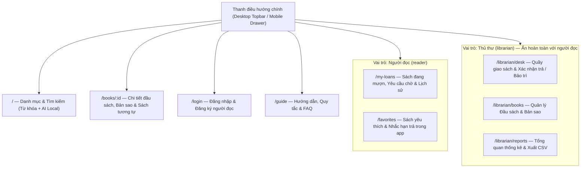

# T02 — Phác thảo luồng người dùng và thiết kế giao diện (F02)

- **Mã công việc:** `T02` (Nhóm Thiết kế — `F02`)
- **Phụ trách:** Lý Thế An (`lythean2508`)
- **Người review:** Phạm Hiển (đồng bộ với `T04` — Chốt quy tắc và mô hình dữ liệu)
- **Tuần thực hiện:** Tuần 1 (`2026-11-30` → `2026-12-06`)

---

## 1. Phân biệt 4 thực thể cốt lõi trên giao diện (Đồng bộ F02 / T04)

Để tránh nhầm lẫn nghiệp vụ xuyên suốt giữa Frontend (An) và Backend (Hiển), mọi màn hình tuân thủ nghiêm ngặt 4 khái niệm:

| Thực thể | Ý nghĩa trên giao diện | Trạng thái hợp lệ | Quy tắc hiển thị & thao tác |
| :--- | :--- | :--- | :--- |
| **Đầu sách (`Book`)** | Tác phẩm / nhan đề chung (VD: *Mắt Biếc*) | `visible = true` (Hiển thị) / `visible = false` (Ẩn) | Không xóa cứng nếu đã có bản sao/lịch sử; sách ẩn không hiện ở danh mục, tìm AI hay sách tương tự (`TC08`, `TC25`). |
| **Bản sao (`Copy`)** | Cuốn sách vật lý cụ thể có dán mã `copy_code` (VD: `VH-001-A`) | `available` (Sẵn có) / `borrowed` (Đang mượn) / `maintenance` (Bảo trì) | Số bản sẵn có trên đầu sách được tính động = số bản có `status === 'available'` (`T08`, `TC21`). |
| **Yêu cầu mượn (`BorrowRequest`)** | Đăng ký mượn theo **đầu sách** do người đọc gửi | `pending` / `fulfilled` / `rejected` / `cancelled` | Tối đa 1 `pending`/người/đầu sách (`TC09`). **Không khóa cứng bản sao** khi đang chờ. Người đọc chỉ hủy được khi `pending` (`TC10`). |
| **Phiếu mượn (`Loan`)** | Giao dịch thực tế gắn với **một bản sao cụ thể** tại quầy | Đang mượn (`returned_at = null`) / Đã trả (`returned_at != null`) | Kiểm tra lại giới hạn `<= 3` cuốn lúc giao (`TC12`). Hạn trả `due_at = issued_at + 14 ngày`. Quá hạn khi ngày máy chủ `> due_at` (`TC16`). |

---

## 2. Sơ đồ điều hướng và phân quyền màn hình (T03, T07)

---

## 3. Đặc tả chi tiết từng màn hình (Wireframe & Trạng thái)

### 3.1. Màn Danh mục & Tìm kiếm theo nhu cầu (`/` — T08, T25, T26)
- **Khu vực đầu trang:**
  - Chuyển chế độ tìm kiếm rõ ràng:
    - **Tab 1 — Tìm từ khóa (`F04`):** Ô nhập tên sách/tác giả (hỗ trợ có dấu và không dấu tiếng Việt), dropdown lọc Chủ đề (`category`), checkbox *"Chỉ hiện sách còn bản sẵn có"*.
    - **Tab 2 — Tìm theo nhu cầu AI Local (`F10`):** Ô nhập câu tự nhiên tiếng Việt + gợi ý mẫu câu thử nhanh + thông báo tiến trình khi nạp mô hình lần đầu (`cold start`) + nhãn cảnh báo rõ nếu AI chưa sẵn sàng và tự chuyển về fallback từ khóa (`T25`, `TC23`).
- **Danh sách kết quả:**
  - Chế độ thường: Lưới thẻ sách có phân trang (`12 sách/trang`), giữ nguyên bộ lọc khi chuyển trang (`TC06`).
  - Chế độ AI: Hiển thị tối đa **Top 5 gợi ý** vượt ngưỡng phù hợp; mỗi thẻ dẫn nguyên văn mô tả gốc, vị trí kệ, số bản sẵn có thực tế và **lý do khớp trích xuất trực tiếp từ trường metadata** (chủ đề / từ khóa / câu mô tả gốc — tuyệt đối không bịa lý do ngoài dữ liệu, không hiển thị cosine như xác suất `AI05`, `AI06`). Nếu không có sách vượt ngưỡng: thông báo rõ *"Chưa tìm thấy sách phù hợp với ngưỡng gợi ý"* kèm nút chuyển sang tìm từ khóa (`TC19`).

### 3.2. Màn Chi tiết sách (`/books/:id` — T08, T13, T27, T32)
- Thông tin đầu sách: Nhan đề, tác giả, chủ đề, vị trí kệ (`shelf`), số bản sẵn có / tổng số bản, mô tả gốc (80–200 từ) và nguồn metadata.
- Bảng danh sách bản sao vật lý (`copy_code` + trạng thái `Sẵn có` / `Đang mượn` / `Bảo trì`).
- Cụm hành động người đọc:
  - Nút **Gửi yêu cầu mượn** (khóa nút kèm giải thích nếu chưa đăng nhập, tài khoản khóa, đã có yêu cầu `pending` cho sách này, hết bản sẵn có, hoặc đã chạm trần 3 cuốn đang mượn).
  - Nút **Lưu yêu thích** (`T32`).
- Khối **Sách tương tự (`T27`):** Hiển thị tối đa 4 sách cùng/gần nội dung (loại trừ chính cuốn đang xem và sách đã ẩn `visible = false`), kèm 2 nút phản hồi **Hữu ích** / **Chưa phù hợp** (`TC25`).

### 3.3. Màn Sách đang mượn, Yêu cầu & Lịch sử (`/my-loans` — T13, T19, T32)
- **Banner nhắc hạn trong ứng dụng:** Cảnh báo vàng cho sách sắp đến hạn (`<= 3 ngày`) và cảnh báo đỏ cho sách `Quá hạn` (`ngày hiện tại > due_at`). Ghi rõ nhắc hạn hiển thị trong ứng dụng (chưa gửi email/SMS trong MVP).
- **Tab 1 — Đang mượn:** Mã bản sao, ngày mượn, hạn trả, nhãn `Đang mượn` / `Sắp đến hạn` / `Quá hạn`.
- **Tab 2 — Yêu cầu mượn:** Trạng thái `Đang chờ` (có nút **Hủy yêu cầu**), `Đã giao` (không có nút hủy tại đây — `TC10`), `Từ chối` (hiện lý do từ chối của thủ thư), `Đã hủy`.
- **Tab 3 — Lịch sử đã trả:** Ngày mượn, hạn trả, ngày trả thực tế.

### 3.4. Màn Quầy Thủ thư (`/librarian/desk` — T14, T20)
- **Phân khu Giao sách (Xử lý yêu cầu `pending`):**
  - Danh sách yêu cầu đang chờ kèm số sách người đọc hiện đang mượn (`X/3`).
  - Dropdown chọn mã bản sao `available` tại quầy → nút **Xác nhận giao sách** (tạo phiếu mượn hạn 14 ngày) hoặc nút **Từ chối** (bắt buộc nhập lý do từ chối).
- **Phân khu Trả sách & Bảo trì:**
  - Ô tìm nhanh theo mã bản sao (`copy_code`), tên sách hoặc mã/tên người đọc.
  - Nút **Xác nhận trả sách** kèm tùy chọn checkbox **"Chuyển bản sao sang Bảo trì (hư hỏng/cần tu sửa)"** + ghi chú tình trạng (`T20`, `TC15`).

### 3.5. Màn Quản lý Kho sách & Bản sao (`/librarian/books` — T09)
- Tách rõ 2 cấp biểu mẫu:
  1. **Biểu mẫu Đầu sách (`Book`):** Kiểm tra dữ liệu bắt buộc (tên sách, tác giả, chủ đề, kệ), đếm số từ mô tả (gắn cờ nếu thiếu mô tả < 30 từ theo `AI01`), nút **Ẩn/Hiện đầu sách** thay vì xóa cứng.
  2. **Ngăn quản lý Bản sao (`Copy`) của từng đầu sách:** Thêm bản sao mới (kiểm tra trùng `copy_code` toàn hệ thống — `TC07`), đổi trạng thái `available` ↔ `maintenance` (không cho sửa thủ công bản đang `borrowed`).

### 3.6. Màn Báo cáo & Xuất CSV (`/librarian/reports` — T31)
- Thẻ chỉ số đối chiếu trực tiếp dữ liệu: Tổng đầu sách hiển thị, Bản sẵn có, Đang mượn, Bảo trì, Phiếu quá hạn, Yêu cầu đang chờ (`TC17`).
- Bộ lọc theo trạng thái phiếu / chủ đề / chỉ xem quá hạn.
- Nút **Xuất CSV (UTF-8 BOM)** cho Danh sách phiếu mượn & quá hạn và Danh sách tồn kho bản sao (chỉ vai trò `librarian` được phép gọi — `F09`).

---

## 4. Ma trận trạng thái giao diện & Thiết kế đáp ứng (T03, T21, TC30)

- **4 trạng thái bắt buộc trên mọi trang dữ liệu:**
  1. `Loading`: Khung chờ rõ ràng, khóa nút bấm lặp (`double-submit`).
  2. `Empty`: Thông báo thân thiện kèm nút xóa bộ lọc hoặc hành động tiếp theo.
  3. `Error`: Thông báo lỗi tiếng Việt dễ hiểu, giữ nguyên dữ liệu người dùng vừa nhập trên form.
  4. `AI Cold-start / Fallback`: Thanh tiến trình nạp model lần đầu và nhãn báo khi chạy chế độ từ khóa dự phòng.
- **Responsive Breakpoints (`TC30`):**
  - Mobile (`360px – 767px`): Menu thu gọn (drawer), lưới sách 1 cột, bảng thủ thư chuyển sang thẻ thao tác dọc dễ bấm bằng ngón tay.
  - Tablet (`768px – 1023px`): Lưới sách 2 cột, bộ lọc gộp gọn.
  - Desktop (`>= 1024px`): Lưới sách 3 cột, thanh điều hướng đầy đủ, bảng dữ liệu rộng.

---

## 5. Hợp đồng API tích hợp giữa Frontend (An) và Backend (Hiển)

Frontend sử dụng tầng dịch vụ `apiClient` hỗ trợ cấu hình `VITE_API_BASE_URL` (mặc định kết nối FastAPI `http://localhost:8000` khi bật `VITE_API_MODE=api`, và có chế độ giả lập đầy đủ trạng thái `localStorage` để chạy độc lập / kiểm thử UI):

| Nhóm | Endpoint dự kiến | Quyền | Ghi chú tích hợp |
| :--- | :--- | :--- | :--- |
| Auth | `POST /auth/login`, `POST /auth/register`, `POST /auth/logout` | Công khai / Đã đăng nhập | Không trả `password_hash`; tự đăng ký chỉ tạo `reader`. |
| Danh mục | `GET /books`, `GET /books/{id}` | Công khai | Trả số bản `available_copies` tính trực tiếp từ bảng `copies`. |
| Kho sách | `POST /books`, `PATCH /books/{id}`, `POST /copies`, `PATCH /copies/{id}` | Thủ thư | Báo lỗi `409` kèm trường `copy_code` nếu trùng mã. |
| Yêu cầu | `POST /borrow-requests`, `POST /borrow-requests/{id}/cancel` | Người đọc | Chặn trùng `pending`; chỉ hủy khi `status == pending`. |
| Giao/Trả | `POST /loans/issue`, `POST /loans/{id}/return` | Thủ thư | Giao trong 1 transaction; trả sách hỗ trợ `maintenance: boolean`. |
| Cá nhân | `GET /me/loans`, `GET /me/requests`, `GET /me/favorites`, `POST/DELETE /me/favorites/{bookId}` | Người đọc | Lọc chặt theo phiên người dùng hiện tại. |
| AI & Gợi ý | `GET /search/semantic?q=...`, `GET /books/{id}/similar`, `POST /feedback` | Công khai / Người đọc | Trả cờ `fallback_used`, `model_status` và đoạn khớp từ metadata. |
| Báo cáo | `GET /reports/summary`, `GET /exports/loans.csv`, `GET /exports/inventory.csv` | Thủ thư | Xuất CSV mã hóa UTF-8 để đọc tiếng Việt trong Excel. |
