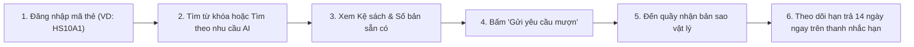

# T44 — Tài liệu Hướng dẫn Sử dụng cho Người đọc và Thủ thư (`F14`)

- **Mã công việc:** `T44` (Nhóm Tài liệu — `F14`)
- **Phụ trách:** Lý Thế An (`lythean2508`)
- **Người review:** Phạm Hiển

---

## 1. Minh họa tổng quan giao diện và luồng thao tác

### 1.1. Luồng thao tác dành cho Người đọc (Học sinh / Giáo viên)


### 1.2. Minh họa bố cục màn hình chính
```text
+-----------------------------------------------------------------------------------+
| [LibMate] Thư viện AI Trường học   Danh mục & AI | Mượn & Lịch sử | Yêu thích (2) |
+-----------------------------------------------------------------------------------+
| [!] Cảnh báo quá hạn / Nhắc hạn trong app: Bạn có sách sắp đến hạn trả. [Xem ngay]|
+-----------------------------------------------------------------------------------+
|  [ Tab 1: Tìm từ khóa & Lọc chủ đề ]   [ Tab 2: Tìm theo nhu cầu bằng AI Local ]  |
|  Ô nhập: "Em hay lo lắng mùa thi..."                         [ Tìm gợi ý AI ]     |
+-----------------------------------------------------------------------------------+
|  Gợi ý #1 | Phù hợp cao | Kỹ năng sống & Tâm lý | Kệ D1-02 | Còn 2/2 bản sẵn có   |
|  Làm Chủ Tuổi Dậy Thì Và Vượt Qua Áp Lực Thi Cử                                   |
|  Bằng chứng khớp từ metadata (category, description):                             |
|  “Cẩm nang tâm lý gần gũi giúp học sinh trung học nhận diện dấu hiệu căng thẳng   |
|   lo âu mùa thi...”                                                               |
|  Đánh giá gợi ý: [Hữu ích] [Chưa phù hợp]                 [Xem chi tiết & Đặt mượn]|
+-----------------------------------------------------------------------------------+
```

---

## 2. Hướng dẫn chi tiết theo vai trò

### 2.1. Dành cho Người đọc (`reader`)
1. **Tra cứu sách thường (`F04`):** Gõ tên sách hoặc tên tác giả (có dấu hoặc không dấu đều được, ví dụ `mat biec` hoặc `Mắt Biếc`), chọn chủ đề môn học và tích *"Chỉ hiện sách còn bản sẵn có"*.
2. **Tìm theo nhu cầu bằng AI (`F10`):** Chuyển sang tab AI, gõ câu tiếng Việt tự nhiên mô tả nhu cầu đọc. Lần đầu mở máy có thể mất vài giây nạp mô hình (`Cold-start`).
3. **Đặt yêu cầu và Hủy yêu cầu (`F06`):**
   - Vào trang chi tiết sách, bấm **Gửi yêu cầu mượn đầu sách này**.
   - Nếu đổi ý trước khi ra quầy, vào **Mượn & Lịch sử** → bấm **Hủy yêu cầu** (chỉ áp dụng khi trạng thái còn là `Đang chờ`).
4. **Sách yêu thích & Theo dõi hạn trả (`F12`):**
   - Bấm `☆ Yêu thích` để lưu sách muốn đọc sau.
   - Thanh nhắc hạn đầu trang tự động báo vàng khi còn `<= 3 ngày` và báo đỏ khi `Quá hạn`.

### 2.2. Dành cho Thủ thư (`librarian`)
1. **Giao sách tại quầy (`/librarian/desk` — Tab 1):**
   - Kiểm tra tên bạn đọc, số sách đang mượn (`X/3`) và chọn đúng mã bản sao vật lý (`copy_code`) đang cầm trên tay → bấm **Xác nhận giao**.
   - Nếu từ chối yêu cầu, bấm **Từ chối** và nhập rõ lý do để bạn đọc xem được trong lịch sử.
2. **Nhận trả sách & Đánh dấu bảo trì (`/librarian/desk` — Tab 2):**
   - Gõ mã bản sao (ví dụ `VHVN-001-A`) hoặc mã học sinh vào ô tìm nhanh.
   - Nếu sách bị rách bìa/bung trang, tích ô **"Cần bảo trì (hư hỏng / rách)"** kèm ghi chú rồi bấm **Xác nhận trả sách**. Bản sao đó sẽ tự động khóa cho mượn cho đến khi bảo trì xong.
3. **Quản lý Đầu sách & Bản sao (`/librarian/books`):**
   - Thêm/sửa thông tin chung ở khung **Đầu sách** (khuyến nghị mô tả `80–200 từ` có nguồn hợp lệ để AI tìm chính xác).
   - Bấm **Quản lý bản sao** để gán thêm mã bản sao duy nhất (`copy_code`). Khi sách ngừng lưu hành nhưng đã có lịch sử mượn, dùng nút **Ẩn** thay vì xóa cứng.
4. **Xem Báo cáo & Xuất CSV (`/librarian/reports`):**
   - Đối chiếu nhanh số lượng Sẵn có, Đang mượn, Bảo trì, Quá hạn và bấm **Xuất CSV** để mở trực tiếp trên Microsoft Excel.

---

## 3. Quy tắc Mượn – Trả & Câu hỏi thường gặp (FAQ)

| Quy tắc / Tình huống | Quy định áp dụng trong MVP |
| :--- | :--- |
| Số sách mượn tối đa cùng lúc | **03 cuốn** đang mượn / người đọc (kiểm tra lại tại thời điểm giao sách). |
| Thời hạn mượn tiêu chuẩn | **14 ngày lịch** kể từ lúc giao sách. Đúng ngày hạn trả vẫn là đúng hạn; qua ngày kế tiếp theo giờ máy chủ mới tính quá hạn. |
| Yêu cầu `Đang chờ` có giữ chỗ bản sao không? | **Không.** Bản sao chỉ được gán khi thủ thư xác nhận giao trực tiếp tại quầy. |
| Tiền phạt trễ hạn / Email / SMS | **Chưa triển khai trong MVP** theo quyết định phạm vi dự án. |

---

## 4. Minh bạch Giới hạn của AI Local (`F10`, `AI05`, `AI06`)
- **Không phải Chatbot toàn văn:** AI không đọc nội dung toàn văn bên trong cuốn sách và không tự sáng tác câu trả lời; hệ thống chỉ đối chiếu ngữ nghĩa trên **tên sách, tác giả, chủ đề và đoạn mô tả ngắn được phép sử dụng**.
- **Bảo vệ quyền riêng tư:** Không gửi dữ liệu cá nhân hay lịch sử mượn của học sinh lên bất kỳ API đám mây trả phí nào.
- **Ngưỡng gợi ý trung thực:** Điểm tương đồng cosine chỉ dùng để sắp xếp Top 5 gợi ý tham khảo; với chủ đề nằm ngoài danh mục trường học (như sửa chữa động cơ tàu thủy, phẫu thuật y khoa sâu), hệ thống sẽ thông báo rõ chưa có sách phù hợp thay vì ép trả kết quả sai.
